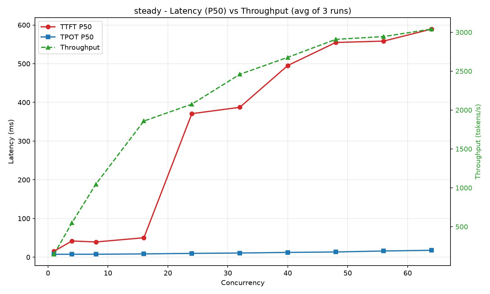
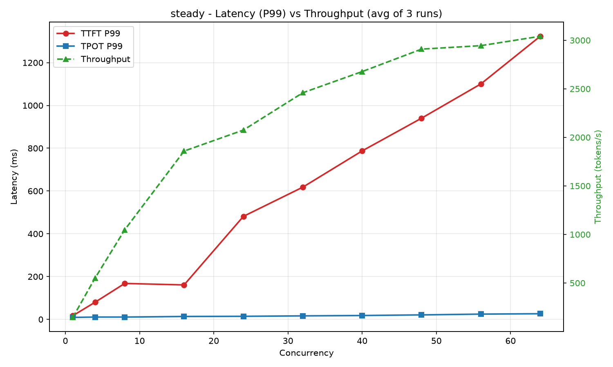
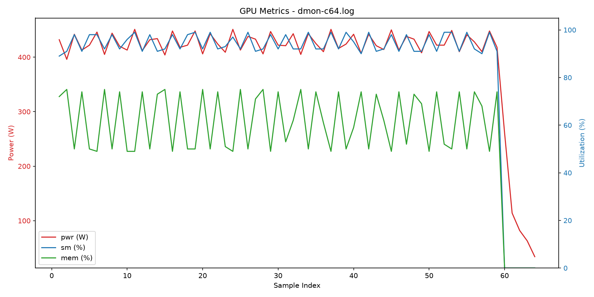
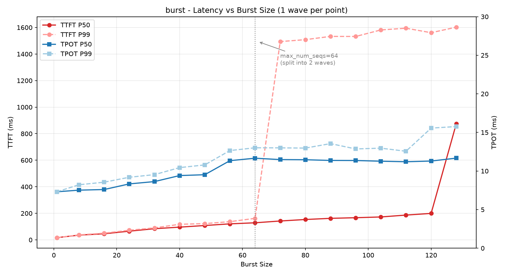

## 环境

## 环境（Baseline）

| 项 | 值 |
|---|---|
| GPU | RTX 4090 24G ×1（驱动 591.86，CUDA 13.1），WSL2 Ubuntu 24.04 |
| 集群 | k3s v1.36.4+k3s1 单节点 |
| 引擎 | vLLM v0.30.0，镜像 vllm/vllm-openai:latest（digest sha256:d076d77d…） |
| 模型 | Qwen/Qwen2.5-7B-Instruct-AWQ（served name: qwen2.5-7b） |
| 引擎参数 | --max-model-len=8192 --max-num-seqs=64 --gpu-memory-utilization=0.85 --enable-prefix-caching |
| CUDA graph 档位 | [1,2,4,8,16,24,32,40,48,56,64,...]（启动日志实测） |
| 访问路径 | bench → kubectl port-forward → Service → vLLM Pod（无网关） |
| client 限核 | taskset -c 0-7（client 与 server 同机，防资源争抢） |

## 指标口径与防污染

- TTFT：请求发出 → 首个非空 content chunk；TPOT：(末chunk − 首chunk)/(completion_tokens − 1)；
  吞吐：Σ completion tokens / 墙钟总时长；P50/P99 按请求分位
- 解码 temperature=0（贪心）；ignore_eos=True（输出长度固定 128，受控变量）
- 随机 prompt（prefix caching 开启状态下防缓存污染）；每组预热 1 发不计入
- 每档重复 3 次取均值；疑点不复现不追
- 变更模型/引擎参数/硬件任一 → 全部重跑，版本号 +1

**steady模式总结**

steady模式模拟用户日常使用场景，并发数就是活跃使用用户数，并且用户是等当前模型跑完一轮结果再进行下一轮，与日常使用相符。
基线测试发现并发数在16~24之间TTFT明显上升（P50和P99表现一致），在此之前TTFT上升缓慢，说明从这里开始，推理引擎里面的请求开始排队，达到了“**以延迟换吞吐**”的饱和区。对于当前配置，如果要将TTFT控制在200ms内，并发数控制在16比较好，如果允许TTFT在500ms以内，则并发可以控制在24。

另外当并发大于48之后，吞吐明显饱和，TTFT仍然是线性增长，说明此时已经基本达到吞吐上限了。我们需要看下究竟什么导致达到了吞吐极限，这里可以发现一个很有意思的问题：从图中能看出反而是prefill阶段吃满了算力资源，而且GPU功耗也打满了。图中每一次功耗上涨，sm利用率也跟着涨到接近100%, 说明prefill阶段已经吃满算力了; 对应的，每一次sm利用率下跌，mem利用率就上涨，说明引擎此时在做decoding，对算力要求低。但dmon 里 fb 20804 MiB 全程恒定 = vLLM 按 0.85 预分配显存池，vLLM已经固定分配好显存了，显存占用与负载无关。至于vLLM内部的显存占用指标，nvidia-smi看不出来，需要后续通过监控系统采集。

最后看TPOT, TPOT耗时体现在单次step里面的kv cache读取和batch decoding. TPOT从并发=8之前，上涨很慢，大于8之后成线性增长趋势。为什么前半段增加并发度，TPOT几乎不变？因为此时算力和显存带宽都还没打满，continuous batching直接把所有请求在一个batch并行处理了，计算一个token的时间几乎不变；此后，随着并发的增加，单位batch已经开始饱和，要获取更多的token，就需要更多的时间，单个请求TPOT等于batch / throughput

**burst模式总结**
burst与steady不同的是只是一次性给大量并发请求，这个更适合用来测试当prefill被打满的时候，更多的请求对TTFT的影响，吞吐值在这里意义不大。从结果来看，当并发超过max_num_seqs时，TTFT上涨了约1.5s, 这也差不多是一批请求完成的时间。当然这里的1.5s是基于当前硬件和测试条件确定了，如果硬件不同，单个请求的max_output_tokens不同，结果也会不同。

另外与steady-64相比，有几个点可以分析一下：
1. TPOT P50指标，burst-64的是11.66ms, 而steady-64为17.79ms，少了约6ms，这其实是因为当max_num_seqs=64被打满时，steady模式持续有新请求进来，新请求必须先完成prefill，这些持续的prefill会吃掉GPU算力，从实验数据上来看，prefill 插入频率 ≈ 23/s，decode step 频率 = 1000/17.79 ≈ 56 step/s，比值 ≈ 0.4——即大约每 2-3 个 step 有一个要扛 prefill，这是TPOP P99涨了约6ms的原因。
2. TTFT P50指标，burst-64只有约128ms，但steady-64则达到了约500ms-600ms，这是因为max_num_seqs=64被打满，burst-64没有新请求进入，每个请求在当前批次完成一次prefill就行了，而steady-64由于持续新进的请求，这些新进的请求需要等上一个batch完成才会开始prefill，从前面的分析看，每2-3个step要抗一个prefill，每个step的耗时17.79ms, 等待的时间加上自身prefill需要的时间，使得TTFT达到了500ms-600ms这个量级了。
3. 吞吐。steady-64吞吐基本饱和（约3k tokens/s），主要是因为持续进入的请求的prefill叠加正在进行的decoding把算力吃满了，这可以从功耗和sm利用率监控看到；burst-64吞吐则达到了5384 tokens/s，这是因为这些请求只做一次prefill，后续都是decoding，prefill更耗算力，没有持续新增请求的prefill负担后，整体吞吐比steady-64模式高很多是符合预期的。

值得注意的是：在做steady baseline实验时，有一次将并发度设置成52了，发现steady-52相比steady-48的吞吐不升反降，这与直觉不符（64并发前，吞吐应该稳定上升的）。后来查阅资料发现是cuda graph档位导致的，具体来说，vllm启动时会根据max_num_seqs捕获离散档位，当前环境的值如下“'cudagraph_capture_sizes': [1, 2, 4, 8, 16, 24, 32, 40, 48, 56, 64, 72, 80, 88, 96, 104, 112, 120, 128]”，此时52会向上padding，step计算时padding消耗算力，但不算token，这就是吞吐不升反降的原因。capture 档位按 token 数计，上限 = min(max_num_seqs × decode_query_len × 2, 512) = 128，为混合 prefill+decode 批次预留（源码 vllm/config/vllm.py）

这里其实也可以发现，在不做PD分离时，我们没法同时将TTFT和TPOT做到最优，这是因为TTFT主要吃算力，而TPOT主要吃显存带宽，从burst模式看，max_num_seqs打满，吞吐达到最大，如果带宽允许，甚至可以调大max_num_seqs增加继续增大吞吐，但steady模式（PD混合调度）下，并发还没到64的时候，TTFT就已经显著增加了，这说明prefill已经和decoding抢资源了。

