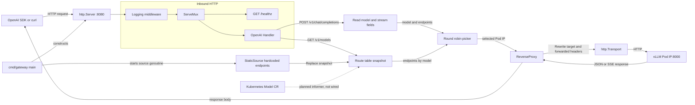

# 设计文档 - gateway
# 反向代理参数梳理

| 参数 | 含义 | 参考取值 | 原因 |
| --- | --- | --- | --- |
| `ReadHeaderTimeout` | 读取完整请求头的超时时间 | `5s` | 尽早结束发送请求头过慢的连接, 降低sowloris(利用慢请求头发送的一种拒绝服务攻击)风险 |
| `ReadTimeout` | 从接受连接开始, 读取完整个请求的最长时间, 包含请求头和Body | `30s`, 可以按请求大小调整 | 限制客户端慢速发送body的场景; 当前场景下JSON较小, 30s足够 |
| `IdleTimeout` | keep-alive 连接完成一个请求后, 等待下一个请求的最长时间 | `60s` | 回收长时间空闲的连接, 他不会限制正在进行SSE响应的时长 |
| `WriteTimeout` | 写响应超时时长, 超时后写响应失败 | 不设置(取0值) | SSE响应可能持续很久, 固定写超时时间可能把正常流式响应阶段 |

## 当前网关架构

下图按当前代码绘制。实线表示已接通的请求或数据路径；虚线表示计划中的 Kubernetes Model CR watch，目前尚未接入。

<!-- mermaid-checked: no \n, no em-dash/en-dash, no {} in labels, subgraphs are id["label"], arrows are -->|"label"|, all subgraphs closed by end, ids unique -->

### 实现状态

| 部件 | 当前实现 |
| --- | --- |
| HTTP 入口 | `:8080`；路由为 `/healthz`、`/v1/models`、`/v1/chat/completions`；请求经过 Logging middleware |
| 路由数据 | `StaticSource` 启动时写入两个硬编码 Pod IP；`namespace` 和 `kubeconfig` 参数已声明但尚未用于连接 Kubernetes |
| 请求调度 | `Handler` 读取并恢复请求 body，按 model 取 endpoints，再由 `RoundRobinPicker` 按模型轮询选择实例 |
| 上游代理 | `ReverseProxy` 从请求 context 取得选中的目标并经自定义 `Transport` 转发；客户端断连沿请求 context 传递 |
| 连接池 | Dial timeout `5s`、每 host 空闲连接 `256`、全局空闲连接 `256`、空闲超时 `90s`；未设置 `ResponseHeaderTimeout` |
| 预留功能 | Kubernetes informer、认证和限流 middleware 尚未启用 |

### 当前需要留意

- `http.Server` 当前实际配置 `ReadHeaderTimeout=10s` 和 `WriteTimeout=60s`，没有显式设置 `ReadTimeout`、`IdleTimeout`。因此当前 `WriteTimeout` 可能截断超过 60 秒的 SSE 响应；图表示当前代码状态，不代表推荐的最终超时配置。
- `RouteTable` 的快照读写目前没有锁或原子快照保护；并发请求与快照替换同时发生时需要补并发安全。
